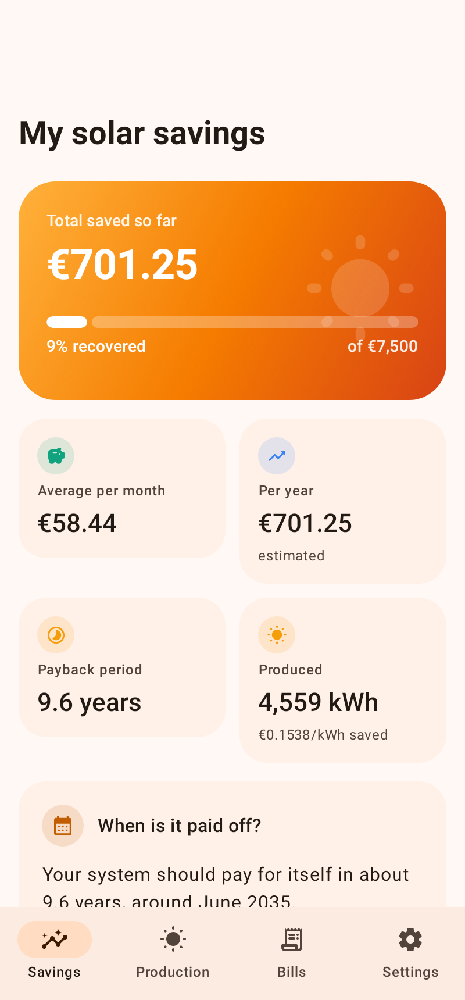
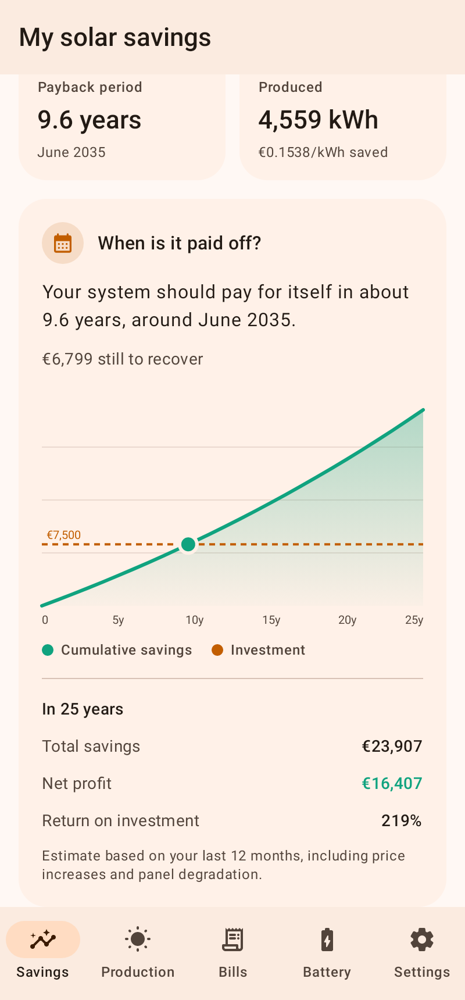
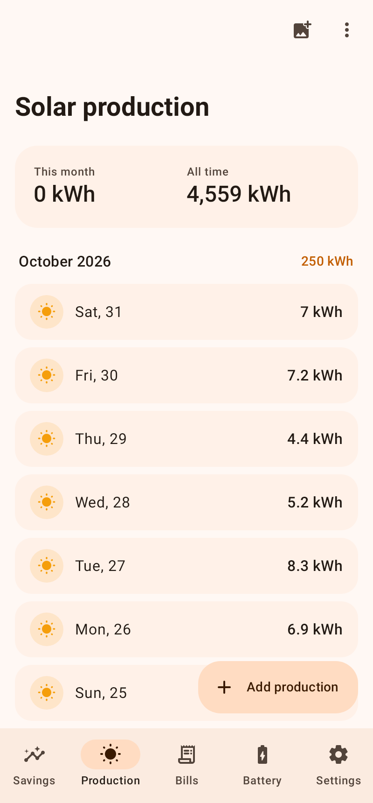
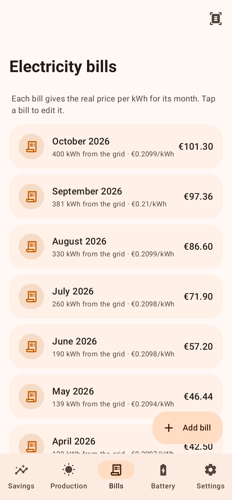
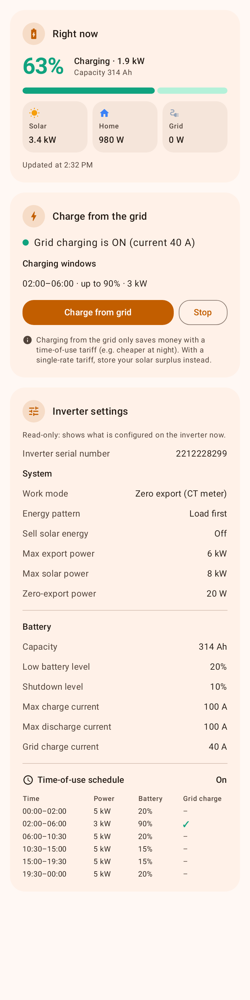
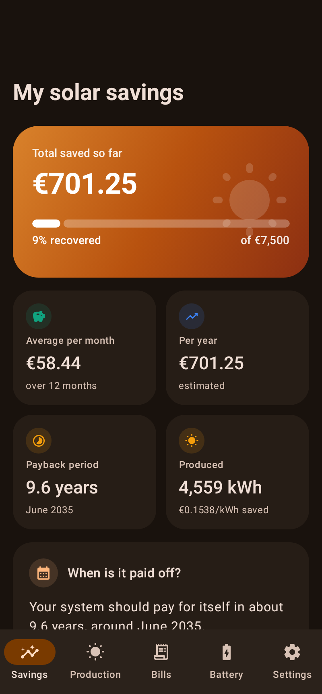
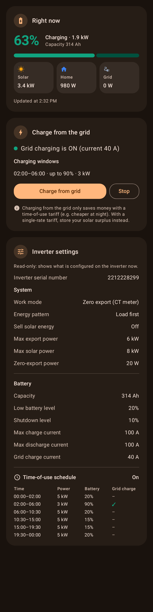
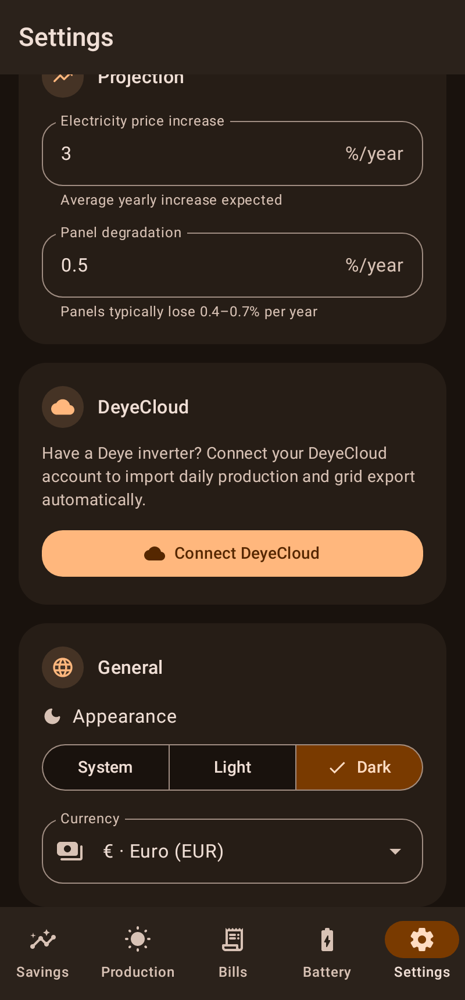

# ☀️ PV Calculator

**How much are your solar panels saving you, and when will they pay for themselves?**

PV Calculator is a free, open-source Android app that works out your monthly savings from your
electricity bills and your panels' daily production. It also estimates how many years it takes
to recover your investment. No account, no ads: your data stays on your phone.

<p align="center">
  
  
  
  
</p>

<p align="center">
  
  
  
  
</p>

## Features

- **Monthly savings**: energy you use from your panels saves its price per kWh, and exported energy earns the feed-in tariff.
- **Payback estimate**: when your system is paid off (years and month), with a 25-year projection, net profit and ROI.
- **Import bill PDFs**: attach the PDF (or a photo) of your electricity bill. The month, total amount, kWh consumed,
  fixed charges and exported energy are read automatically (Portuguese, Spanish, English, French, Italian and German wording).
- **Read inverter screenshots**: take a screenshot of your solar app (Solarman, Deye, FusionSolar, SolarEdge, Growatt, …).
  Production, export, the day or the month are recognised on-device with OCR, even when labels sit above the values or use Wh.
- **Batteries and upgrades**: add extra investments (e.g. a 16 kWh battery) to the payback. Energy stored and used later
  counts as self-consumption.
- **DeyeCloud sync** (optional): connect your Deye inverter account to import daily production and grid export
  automatically through the [DeyeCloud OpenAPI](https://developer.deyecloud.com/start). See below.
- **CSV import** of daily production (`date;kWh[;exported kWh]`), as exported by most monitoring portals.
- **Attachments** are kept with each bill/entry and open with one tap.
- **Backup & restore** to a single `.zip` file (data + attachments).
- Light and dark theme (follow the phone or choose in Settings → Appearance), any currency, English and Portuguese.

## DeyeCloud sync (Deye inverters)

1. Sign in at [developer.deyecloud.com](https://developer.deyecloud.com/start) with your normal DeyeCloud account,
   using the same data center (Europe, Americas or India).
2. Create an application to get an **App ID** and **App Secret**.
3. In the app, open **Settings → DeyeCloud → Connect DeyeCloud** and enter them with your DeyeCloud e-mail/username and password.
4. Choose your station. The app imports daily production (`generationValue`) and grid export (`gridValue`) since
   the installation date, and keeps them up to date when you open the app (at most every 6 hours) or tap *Sync*.

The password is hashed (SHA-256, as the API requires), sent only to DeyeCloud to obtain a 60-day token, and never stored.
The App Secret and token stay in the app's private storage and are excluded from Android backups and from the app's own backup file.
Synced days replace manual entries for the same days, and manual whole-month entries for the same month, so nothing is counted twice.

## How the numbers are calculated

For every month with recorded production:

| Value | How |
|---|---|
| Price per kWh | From that month's bill: `(total − fixed charges) ÷ kWh bought`. Without a bill, the default price from Settings. |
| Exported energy | From the bill, else from the inverter (screenshot/CSV), else estimated with the self-consumption % |
| Self-consumed energy | `production − exported` (includes energy that went through a battery) |
| Savings | `self-consumed × price + exported × feed-in tariff` |

**Payback**: yearly savings come from the last 12 months. With less data they come from the expected annual production,
or are extrapolated from the months recorded. These savings are projected into the future with the expected electricity
price increase and panel degradation, until they cover the total investment (installation plus extras).
Time between the installation date and your first record is estimated.

## Install

Download the APK from the [Releases](../../releases) page (or from the latest *Android build* run in the Actions tab):

- `app-arm64-v8a-release.apk`: most phones from the last ~8 years
- `app-universal-release.apk`: works on every device (bigger)

Allow installing from unknown sources when Android asks.

## Build from source

Requirements: JDK 17+ and the Android SDK (API 35).

```bash
./gradlew :app:assembleRelease            # APKs in app/build/outputs/apk/release
./gradlew :app:testDebugUnitTest          # unit tests (parsers, calculator) + screenshots
```

Release builds are signed with your own key when these environment variables are set:
`PV_KEYSTORE_FILE`, `PV_KEYSTORE_PASSWORD`, `PV_KEY_ALIAS`, `PV_KEY_PASSWORD`. Otherwise they use the debug key.

In GitHub Actions, the key comes from the repository secrets `PV_KEYSTORE_BASE64` (the `.jks` file in base64),
`PV_KEYSTORE_PASSWORD`, `PV_KEY_ALIAS` and `PV_KEY_PASSWORD`. Every release must be signed with the same key,
otherwise Android refuses to update an installed app. Keep a backup of the keystore and its password.

### Project layout

```
app/src/main/java/io/github/c0dewars/pvcalculator/
├── data/      storage (JSON + attachments), backups, PDF/OCR text extraction
├── domain/    savings & payback calculator, bill parser, screenshot parser, CSV importer (pure Kotlin, unit-tested)
└── ui/        Jetpack Compose screens, charts and theme
```

Adding support for a new bill format or monitoring app usually just means adding keywords in
`BillParser.kt` / `ProductionParser.kt`, plus a test. Contributions are welcome!

## Privacy

Bills and screenshots are processed on the device (PDF text extraction with PdfBox-Android, OCR with Google
ML Kit's bundled on-device model) and never leave it. The app's own network traffic is only the optional DeyeCloud sync,
directly between your phone and DeyeCloud. Note that the ML Kit library may send anonymous diagnostics to Google.

---

### 🇵🇹 Em português

A **Calculadora PV** calcula quanto poupa por mês com os painéis solares, a partir das faturas de eletricidade e da
produção diária. Também estima ao fim de quantos anos o investimento fica pago. Importe as faturas em PDF e os
screenshots da app do inversor e os valores são lidos automaticamente. Não precisa de conta e os dados ficam no telemóvel.

## License

[MIT](LICENSE)
